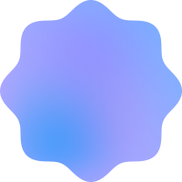
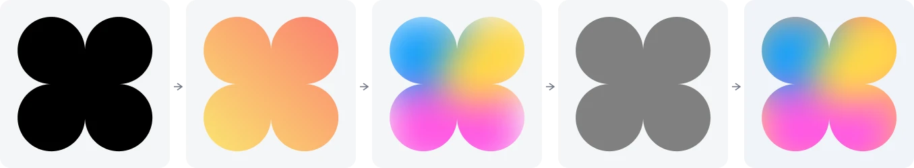

<p align="center">
  
</p>

A collection of 440+ free vector assets and grainy gradient graphics for modern web interfaces.

[Live Site](https://shaape.co)

## Overview

Shaape provides 440+ vector assets across diverse categories: Arrows, Badges, Cyber, Flowers, Stars, Geometry, and Abstract seals. Every asset comes in multiple visual styles:

- **Normal**: Smooth solid vectors with clean edges
- **Gradient**: Vibrant multi-color gradient fills
- **Grainy**: Textured noise gradients using native procedural SVG filters (`feTurbulence`)

## Anatomy

<p align="center">
  
</p>

## Quick Start

Run the local development server:

```bash
bun dev
```

Or build for production:

```bash
bun run build
```

## References

- [Coolshapes](https://github.com/realvjy/coolshapes): Original inspiration by realvjy
- [W3C Filter Effects](https://www.w3.org/TR/filter-effects/): Specification for `feTurbulence` and `feBlend`
- [MDN SVG Filters](https://developer.mozilla.org/en-US/docs/Web/SVG/Element/feTurbulence): Procedural noise in vector documents

## License

Free to use in personal and commercial work.
